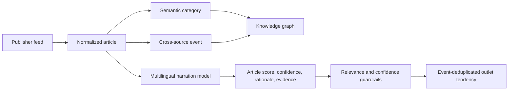

# News knowledge and narration intelligence

Status: multilingual ML v3 with durable article workflows, August 2026

## Product story

A newsroom receives several accounts of the same real-world event. The system therefore keeps article, event, category, publisher, and narration as separate concepts:

1. A publisher produces an article.
2. The article is normalized and assigned a semantic category.
3. Similar reports are clustered into one event.
4. Events become nodes in the knowledge graph and timeline.
5. A multilingual model evaluates each article's editorial and political narration.
6. Only repeated, confident, relevant results contribute to an outlet tendency.

Reporting about a left-wing party is not automatically left-wing reporting. Party identity alone is not directional evidence: the model evaluates the journalist's framing, selection, emphasis, and attribution.



## Knowledge-page interaction

The event map fills the content container. Category nodes sit on the left, event nodes occupy the timeline, and publisher nodes sit on the right. Users can:

- pan the graph by dragging empty canvas space;
- zoom around the pointer without scrolling the page;
- use accessible zoom-in, zoom-out, and reset controls;
- select an event with a pointer or keyboard;
- inspect its reports in a Shadcn scroll area that supports wheel, trackpad, scrollbar, and drag scrolling;
- filter the server-rendered graph using preset or custom date ranges and category URL parameters.

## Two different political views

The UI deliberately shows two related but independent views.

### Curated party-policy reference

The party map is a human-reviewed reference on one named axis:

> Economic policy: state-led (-1) to market-led (+1)

It is not a moral rating, a truth score, or the source of an article score. Each placement has a confidence, rationale, and evidence links so an editor can challenge and revise it.

| Party | Position | Display band | Initial rationale | Confidence |
| --- | ---: | --- | --- | ---: |
| Frontline Socialist Party (FSP) | -0.95 | Far left | Explicit Marxist orientation | 0.82 |
| Janatha Vimukthi Peramuna (JVP) | -0.90 | Far left | Marxist-Leninist roots and socialist programme | 0.92 |
| National People's Power (NPP) | -0.40 | Center-left | Equity and social protection combined with a mixed economy | 0.78 |
| Sri Lanka Freedom Party (SLFP) | -0.25 | Center-left | Historically state-oriented, with later market-policy convergence | 0.70 |
| Sri Lanka Podujana Peramuna (SLPP) | +0.05 | Center | Economically mixed and populist | 0.55 |
| Samagi Jana Balawegaya (SJB) | +0.15 | Center | Social-market welfare commitments with market-friendly policy | 0.62 |
| United National Party (UNP) | +0.55 | Center-right | Historically the strongest market-liberal major party | 0.82 |

Initial evidence includes the [Election Commission party register](https://elections.gov.lk/en/political_party/political_party_list_E.html), [NPP policy site](https://www.npp.lk/en), [JVP publications](https://www.jvpsrilanka.com/english/), [Verité Research party mapping](https://www.veriteresearch.org/publication/mapping-sri-lankas-political-parties/), and [LSE research on the JVP](https://eprints.lse.ac.uk/41306/).

### Machine-scored article narration

The analyzer is `editorial-stance-ml-v8`. Combined `article_analysis` supplies narration from the configured Codex model, with `narration_framing` as the per-step fallback. Both paths use the same prompt and schema. The model applies `political_relevance`: reports without meaningful political or public-policy framing return left=0, center=1, right=0. There is no keyword gate before inference.

Relevant reports return a left/center/right probability distribution totaling 1. Left includes redistribution, labour power, state provision, progressive social policy, and criticism of entrenched hierarchies. Right includes market allocation, private enterprise, lower regulation or taxation, traditional social order, and nationalist/conservative framing. Center includes neutral attribution, balanced or mixed treatment, descriptive reporting, and weak directional evidence. The label follows the dominant probability; ties resolve to neutral. A compatibility score is derived as right minus left.

## Article algorithm

### 1. Prepare untrusted text

The worker uses the headline and rights-permitted captured article text, falling back to the feed description. Cleaning removes scraper debris and preserves faithful Markdown. Standalone narration receives up to 1,800 characters of summary and 9,000 characters of cleaned text; the combined prompt evaluates the headline, the first 1,800 summary characters, and the first 6,000 cleaned characters. Article text is untrusted data and must never override the prompt.

### 2. Request structured ML inference

```json
{
  "political_relevance": 1,
  "left_probability": 0.7,
  "center_probability": 0.2,
  "right_probability": 0.1,
  "confidence": 0.78,
  "rationale": "The journalist endorses public provision for universal access.",
  "evidence": ["essential services must remain publicly owned"]
}
```

The prompt requires journalist-authored directional evidence, distinguishes quotations from editorial framing, and forbids inferring a permanent publisher label from one article. Parsing validates relevance, probability ranges and total, confidence, evidence limits, unknown fields, and trailing JSON. Irrelevant results are normalized to score 0, label `unclear`, and distribution 0/1/0. Historical economic-axis responses remain readable for compatibility.

### 3. Persist provenance

Every result stores:

- algorithm version;
- relevance, left/center/right probabilities, derived score, label, and confidence;
- rationale and evidence phrases;
- provider ID and provider model;
- analysis timestamp.

Changing the algorithm version automatically makes older articles eligible for backfill without modifying their source data.

## Outlet aggregation

An article result contributes only when it is relevant and uses the current model. A confidence of `0.60` is required for directional aggregation.

Reports from the same source about the same clustered event are first collapsed into one sample. This prevents repeated updates or near-duplicates from giving one event disproportionate influence.

For each outlet:

```text
event_score = confidence_weighted_mean(article_scores_in_event)
raw_outlet_score = confidence_weighted_mean(event_scores)
displayed_score = raw_outlet_score × n / (n + 5)
```

The final term is neutral shrinkage: small samples move toward zero. The UI requires at least five confident, relevant event samples before placing an outlet on the spectrum. Five is a bootstrap threshold for the local corpus, not a publication-grade statistical guarantee; raise it after recall and coverage are measured.

The result always describes the selected time and category window. It is a recent narration tendency, not a permanent political identity.

## Metric contract

| Metric | Grain | Definition | Guardrail |
| --- | --- | --- | --- |
| Relevant narration | Article | Meaningful political or public-policy framing is present | Irrelevant stories abstain and score zero |
| Narration score | Article | Right probability minus left probability (`-1..+1`) | Direction is visually uncertain below `0.60` confidence |
| Evidence | Article | Up to three short phrases supporting the result | Must come from supplied article text |
| Scored events | Source × window | Distinct relevant events at or above `0.60` confidence | Avoids duplicate-event weighting |
| Outlet tendency | Source × window | Confidence-weighted, neutral-shrunk mean | Minimum sample and URL-scoped recomputation |
| Party baseline | Party | Human-curated economic-policy reference | Never enters article or outlet score calculation |

None of these metrics determines truth, factual accuracy, intent, party support, or an outlet's immutable ideology.

## Data model and runtime

Migration `000017_political_framing` introduced party references and article analysis. Migration `000019_narration_framing` adds relevance, label, rationale, evidence, and model provenance. Migration `000022_article_pipeline` adds durable article runs, step telemetry, and article-linked model calls.

The LLM gateway uses database-configured Codex task profiles. Migration
`000052_codex_cli_provider` replaces the historical OpenRouter assignments
from migrations `000026` and `000028`. Active inference uses only `codex_cli`;
model and reasoning effort are editable from AI routing. Historical provenance
is retained. See [the gateway architecture](llm-gateway.md).

### Durable per-article workflow

Every new article creates one persisted run immediately after insertion. The combined `article_analysis` call supplies cleaning, category, summary, and narration results; individual tasks remain per-step fallbacks. River executes the durable ordered steps:

1. `content_cleaning` — captures the combined result and validates faithful Markdown, with standalone cleaning as fallback;
2. `summarization` — validates the combined summary/key points, with standalone summary as fallback;
3. `categorization` — uses deterministic rules and the combined category, with individual Codex classification when needed;
4. `event_clustering` — attaches published reports to a cross-source event or creates one. Headline similarity misses one incident told in different words or with different figures, so a report still alone in its event is then offered, with up to 12 earlier events from the last 36 hours with the closest headlines, to the `event_matching` model. When it names one, the report joins that event and its own event is marked `merged`. Only earlier events are offered (so two lone reports cannot join each other both ways), and only while nothing (a social post, front-page placement or report) refers to the report's own event. Without a model answer the report keeps its own event;
5. `stance_evaluation` — persists the combined model-applied political relevance and narration, with individual Codex narration when needed;
6. `event_synthesis` — refreshes the cross-source event analysis from approved reports. Where outlets give different figures for the same thing (such as a death toll), the summary states each figure with the outlet that reported it.

River retries transient failures at most five times. A retry starts the same run, skips steps already marked `succeeded` or `skipped`, and resumes the failed step. The dispatcher recreates runs missing after an interrupted insertion and recovers runs left `running` for more than 50 minutes. An editor can retry the failed step from the article detail page; resetting an earlier step also resets its dependent later steps.

Queue history is capped at seven days. A daily River maintenance job deletes terminal pipeline runs, their step logs, and their linked model-call telemetry after that window; active runs are preserved. Articles keep a compact `pipeline_enqueued_at` marker so deleting old telemetry never causes completed articles to enter the backfill queue again. The Queue Monitor API also enforces the seven-day window, and its UI defaults to article pipelines while exposing routine polling, dispatch, brief, narration, and cleanup jobs through the job-type filter.

The article explorer is server-paginated at `/articles`. `/articles/:id` shows the stored report, classification and cluster provenance, political score and evidence, each run and step attempt, duration and error, and every linked LLM call. The admin API equivalents are `GET /api/admin/articles`, `GET /api/admin/articles/{id}`, and `POST /api/admin/articles/{id}/pipeline/run`.

The knowledge-graph API returns current article evidence, party references, outlet aggregates, minimum sample, and model metadata for the selected server-side scope.

Core implementation files:

- `services/api/internal/politics/analyze.go`
- `services/api/internal/pipeline/store.go`
- `services/api/internal/jobs/river.go`
- `services/api/internal/llm/gateway.go`
- `services/api/internal/desk/articles.go`
- `services/api/migrations/000028_openrouter_routing.up.sql`
- `services/api/migrations/000019_narration_framing.up.sql`
- `apps/admin/src/pages/knowledge-graph-page.tsx`
- `apps/admin/src/pages/articles-page.tsx`
- `apps/admin/src/pages/article-detail-page.tsx`

## Validation and promotion path

The routing model is a zero-shot ML baseline, not a scientifically calibrated Sri Lankan media-bias classifier. Before production claims are made:

1. Sample at least 500 excerpts balanced across Sinhala, Tamil, English, publishers, subjects, and score bands.
2. Split evaluation data by event and time so syndicated or near-duplicate reports cannot leak between train and test.
3. Ask at least two Sri Lankan political-context annotators to label relevance, narration direction, confidence, evidence, and whether language is quotation or reporter framing.
4. Measure inter-annotator agreement and adjudicate disagreements.
5. Report macro F1 per language, relevance precision/recall, mean absolute score error, calibration error, and confident-score coverage.
6. Inspect counterfactual tests where party names are swapped but the editorial framing is unchanged; the score should remain stable.
7. Run prompt/model candidates in shadow mode and store disagreements for editorial review.
8. Promote a new version only when it improves calibrated precision across languages, not just majority-class accuracy.

A later fine-tuned multilingual encoder may be cheaper and more reproducible at scale. It should replace this baseline only after the labeled dataset exists; selecting an architecture before that evidence would be premature.

## Operational checks

After a model or migration change:

1. Run database migrations.
2. Confirm the configured provider and exact model are reachable from the worker.
3. Restart the worker and verify `llm_calls` outcomes.
4. Compare published, analyzed, relevant, and high-confidence counts.
5. Review examples near `-1`, `0`, and `+1` in every supported language.
6. Confirm party-name-only and non-political stories abstain.
7. Confirm sources below the minimum sample remain unplaced.
8. Test preset/custom date and category URL filters.
9. Run race-enabled Go tests, vet, admin tests, type checking, and production builds.
10. Browser-test evidence tooltips, keyboard navigation, pan/zoom, and article-rail scrolling.

Every visible score must remain traceable to a model version, confidence, rationale, and source-text evidence.
